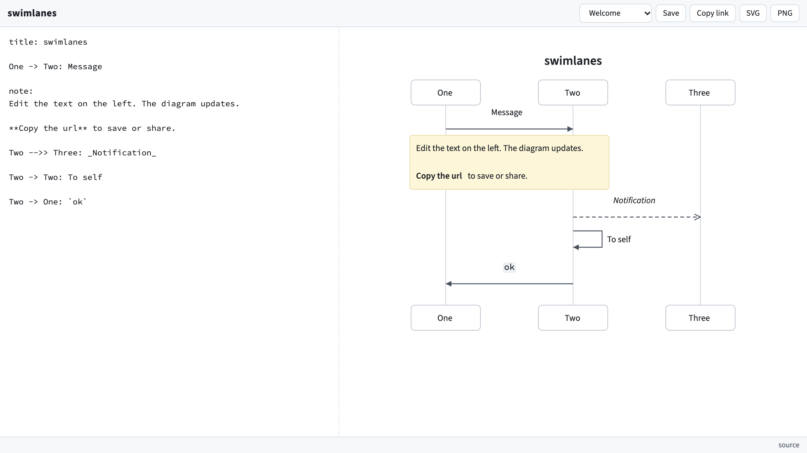

# swimlanes



Sequence diagrams from text. Runs on Cloudflare Workers.

## Use

- Live app: https://swimlanes.dev-4cb.workers.dev
- Syntax: [docs/syntax.md](docs/syntax.md)
- Examples: [examples](examples)

The URL holds the diagram. Copy the URL to share it. To get a short link, press
**Save**.

## Develop

```
npm install
npm run dev
```

## Test

```
npm run test
npm run e2e:install
npm run e2e
```

## Deploy

```
wrangler login
wrangler kv namespace create DIAGRAMS
```

Put the returned id in `wrangler.toml`, then:

```
npm run deploy
```

## License

MIT. The Font Awesome Free webfonts in `public/fa` use the SIL OFL 1.1.
